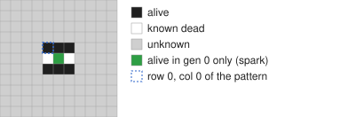
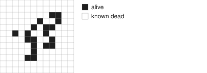
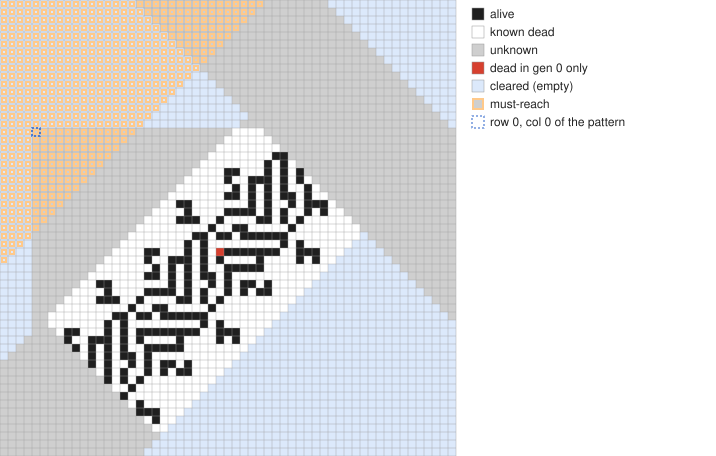
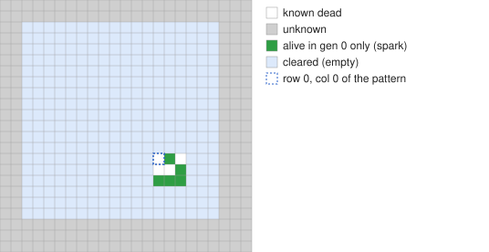
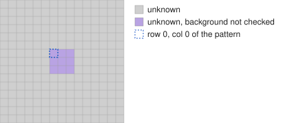

# Finding things with drift

This guide shows how to set up searches for:
- oscillators;
- sparky oscillators;
- spark converters;
- wires;
- turns.

Every example was actually run in B3/S23-a5, and the pictures are drawn from
the example configs by `docs/render.py`. For option details see
[README.md](../README.md).

## The idea in one picture



drift keeps two patterns:

- **the background**, which must be a still life, made of the black (alive)
  and white (known dead) cells; and
- **generation 0**, which is the background plus a few changed cells, here
  the one green cell.

Everything gray is **unknown**. drift runs the disturbance forward one
generation at a time. Whenever the next generation depends on an unknown
cell, it tries that cell both ways, keeping only choices that leave the
background stable. A branch is dropped as soon as the disturbance grows past
your limits:
- `max-changed`: how many changed cells are allowed in a generation;
- `size`: the box those changed cells must fit in.

Each branch ends as:
- an **oscillator** (the changes repeat);
- a **fizzle** (the changes die out and the background is untouched);
- **max gen** (the disturbance is still going: a moving signal).

Results are **partial**: only the cells the reaction needed are known.

## The workflow

```
./drift my.cfg --jsonl results.jsonl --per-rotor 8          # 1. search
RULE=$(./drift --rule B3/S23-a5 --show-rule | sed -n 's/^MAP: *//p')
python3 tests/complete.py results.jsonl --rule "$RULE" \
        --best real.txt --minimize                            # 2. finish & shrink
```

Step 2 does four things:
- it fills in the unknown cells with a SAT solver so the background is a real
  still life;
- it checks that the finished pattern really does what drift reported;
- it shrinks the stator;
- it keeps one pattern per distinct rotor.

`real.txt` is plain RLE in your rule, ready to paste into Golly. Pasting
drift's own output into Golly doesn't work: the unknown cells become dead,
and the LifeHistory rule it uses runs plain Life.

Keep the output small:
- `--per-rotor N`: at most N results per rotor;
- `--max-results N`: default 10,000;
- `no-pics` / `no-rle`: leave pictures and RLE out of the text output (the
  JSON keeps the RLE).

## 1. Oscillators from a spark


The simplest search: one cell switched on in a completely unknown background.
drift builds whatever stable background makes the disturbance repeat.

```
rule = B3/S23-a5
max-changed = 6
size = 4x4
skip = fizzle, stable
min-period = 4
pattern:
x = 1, y = 1, rule = LifeHistory
C!
```

**Found:** in 22 seconds, 180 distinct rotors from p4 to p15, all completed,
shrunk and checked (`attempts/a5/oscillators.txt`). Here is the p15:


**Variations:**
- Raise `max-changed` and `size` for bigger rotors and usually higher periods;
  the search grows quickly.
- Start from a cell switched *off* (state 4 on a live cell), or a pair of cells.
- `complete.py --no-billiards` drops oscillators whose rotor is walled in by
  its stator.

## 2. Sparky oscillators


**Goal:** an oscillator that throws a spark into empty space once per period.

**Setup:**
- Everything above row 0 is cleared, so there's guaranteed empty space to
  spark into.
- The starting spark sits on its edge.
- `must-reach` (orange) keeps only results that put live cells into that
  space.

```
rule = B3/S23-a5
clear = r -60 -60 -1 60
must-reach = r -60 -60 -1 60
skip = fizzle, stable
min-period = 5
per-rotor = 5
pattern:
x = 1, y = 1, rule = LifeHistory
C!
```

Then complete with the empty area protected:

```
python3 tests/complete.py results.jsonl --rule "$RULE" --best sparky.txt \
        --minimize --sparky --keep-empty "-60 -60 -1 60"
```

`--sparky` keeps only oscillators whose own cycle sparks; many reactions
spark only once on the way in. Results are sorted by how far the spark sticks
out: depth 1 means born next to the object, 2 means a free spark.

**Found:** few. Of 206 rotors from two one-minute runs, 4 completed with a
spark in their own cycle, and 3 of those passed the independent check
(p5, p6, p10). Sparky oscillators are rarer, so give this search more time
and bigger limits.

## 3. Spark converters


**Goal:** a still life that takes a spark in on one side and throws one out
somewhere else, then recovers.

**Setup:**
- The still life is confined to a box (gray) by clearing everything around it.
- The input spark arrives from the left.
- `must-reach` requires a live cell just outside the box, at least 4 cells
  from the input.
- `skip = oscillator, stable` keeps only reactions after which the still life
  recovers.

`attempts/a5/make_converter.py H W C SIZE` writes the config.

**Found:** with a 9×9 box and 10 changed cells in 6×6, an 18-cell converter
in 0.3 s (`attempts/a5/converters.txt`):
- the spark arrives at gen 0;
- the output spark appears above the still life at gen 5;
- the still life recovers at gen 7.



The isolated cell on the left is the input spark.

## 4. Wires

**Goal:** a thin still life along which a signal travels forever, like Life's
2c/3 wire.

**How:**
- Start from a spark.
- Allow plenty of room: `margin = 50`. The border is required to be stable,
  so a signal that runs into it is cut off rather than faked.
- Report what's still going at `max-gen`: `skip = oscillator, fizzle, stable`.

A signal that keeps moving builds its own wire as it goes. Two options steer it:
- `--push "right c/2 3"`: every new change must keep up with c/2 to the right,
  with 3 cells of slack.
- `--push "1,2 c/6"`: oblique directions, here 1 down and 2 right per 6 gens.

Checking a candidate:
1. **Does it repeat?** Shift the known background along the signal's path
   and see whether it matches itself.
2. **Build it and run it.** Repeat that unit many times, start a signal, and
   watch it travel.

**Found:** a run with no `--push`, 6 changed cells in 4×4 and max gen 80
produced a diagonal **5c/11 wire**:
- the signal moves 10 cells diagonally every 22 generations;
- the wire's structure repeats every 10 cells along the diagonal.

The candidate was spotted in drift's output and confirmed by building and
running it:


The signal is started at the lower left and runs up and to the right.

`--push` scans with fixed speeds and directions (`attempts/a5/wires/make_wire.py`)
found nothing in 12 s each. The free run worked better: it lets the signal pick
its own speed.

## 5. Turns



**Goal:** a still life at the end of the wire that sends the signal off at
90°.

**The input** (`attempts/a5/turns/make_turn.py left|right T REACH`):
- a cut piece of the 5c/11 wire, carrying its signal in its one-cell phase
  (red: a wire cell that is dead in gen 0);
- cleared space beside the wire;
- an unknown turn zone past the cut, and everything straight ahead cleared,
  so the signal can't simply carry on;
- an arrival zone (orange) far along the new direction, which the signal has
  to reach.

A `--push` on the movement the old and new directions share keeps the signal
moving the whole time. For a left turn both go up; for a right turn both go
right.

Results still going at max gen are turns that build their own outgoing wire.
Fizzles that reach the arrival zone are wire-to-spark converters.

**Found so far:** nothing. 18 runs covered both directions, turn zones of 8,
12 and 16 cells, and 10, 12 and 14 changed cells. The 10- and 12-cell
searches finished completely; the 14-cell ones hit their step cap. In every
case the signal turned into an oscillator at the end of the wire, never a
new signal.

**The next idea:** supply the outgoing wire too. Place a copy of the wire
rotated 90° (the rule is isotropic) beyond the gap, and let drift search only
for the connector. That is a much smaller problem than building the corner
and a new wire at once.

## 6. Other classics

**Glider eaters** (`examples/glider-eater.cfg`): a glider flies through a
cleared path. Eaters show up as fizzles named `g-eater …`.



**Symmetric billiard tables** (`examples/billiard-rot180.cfg`, Sokwe's setup):
- the centre 3×3 is unknown and its background is unchecked (`4` cells);
- the background has 180° symmetry.



## Pitfalls

- **Pasting into Golly.** drift's RLE is a partial pattern in LifeHistory.
  Use `complete.py` to get real patterns.
- **Results that can't be completed.** drift checks each 3×3 window on its
  own, so a large partial background can be impossible to finish. This is
  most likely after long transients. `--best` tries other results with the
  same rotor.
- **Storage.** A search with loose limits can report millions of results.
  Always use `--per-rotor`, and keep `--max-results` on.
- **The border.** drift requires the space's dead border to be stable;
  `--unchecked-border` gives dr2's behaviour. Without that check, signals
  reaching the edge produce fake results.
- **Your own drawings.** `docs/render.py my.cfg out.svg` draws any config, so
  you can check your regions before a long run.
