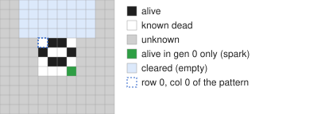
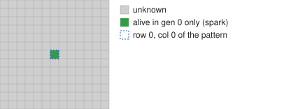
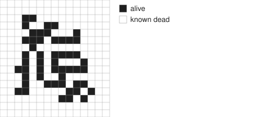
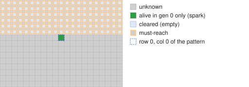
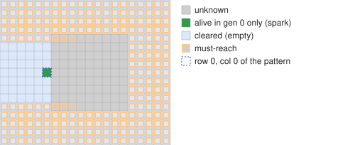
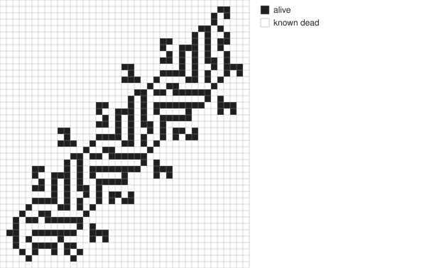

# Building drift searches

0. [Surveying a whole rule](#0-surveying-a-whole-rule)
1. [What drift does](#1-what-drift-does)
2. [Anatomy of an input file](#2-anatomy-of-an-input-file)
3. [Building one, step by step](#3-building-one-step-by-step)
4. [Reading the results](#4-reading-the-results)
5. [Recipes](#5-recipes)
6. [Troubleshooting](#6-troubleshooting)
7. [Reference](#7-reference)

**In a hurry?** `./drift survey RULE` runs a standard set of searches for you
(next section). Read on when you want a search of your own.

## 0. Surveying a whole rule

    ./drift survey B3/S135                    # 10 minutes on every core
    ./drift survey B3/S135 --minutes 30 --threads 8
    ./drift survey B3/S135 --resume --minutes 30   # carry on where it stopped

This first runs random soups for 10 seconds to find the rule's common
spaceships (`--census`; give your own with `--ship FILE` or `--ship 'RLE'`).
Then it runs these searches together:

| search | looks for |
|---|---|
| `osc` | oscillators, catalysts and signals still travelling from one spark (6 cells in 4x4) |
| `sparky` | oscillators that throw a spark into empty space |
| `drifters` | disturbances that keep moving onto fresh cells: wires, signals, drifters |
| `converter` | a spark in, another spark out, and the still life recovers |
| `SHIP-eaters`, `SHIP-converter`, `SHIP-drifter` | per spaceship: eaters, ship converters, ship → signal; the limits grow with the ship |

All the searches share the cores, and when one finishes its threads move to
the ones still running. Each search starts small and gets deeper: when one is
complete and time is left, the next level starts as `NAME-2` (2 more changed
cells, a box 1 larger each way), then `NAME-3`, and so on, each with its own
results. A level that keeps nothing is rerun in place instead (with 4 more cells
and a box 2 larger if it found nothing at all: its limits were too small for
the rule). When time is up, each unfinished search saves a checkpoint, so
`--resume` carries on with it, deeper levels included. Then `finish.py` checks
each search's results (most promising first, at most `--finish-minutes`,
default 3). Everything goes into `surveys/RULE/`:

- `SUMMARY.md`: what each search found; the oscillators by period and the
  smallest catalysts across all searches; the best patterns of each search;
- `NAME-finished.txt`: complete patterns;
- `NAME.cfg`: the config, ready to run or edit on its own.

`--list` shows the searches without running them, and `--jobs osc,sparky`
picks some of them.

## 1. What drift does

You give drift two things:
- a **still life**, usually only a small part of one;
- a **spark**: a few cells that differ from it in generation 0.

Every cell you don't specify is **unknown**. drift runs the spark forward one
generation at a time. When the next generation depends on an unknown cell, it
tries that cell both ways, always keeping the still life stable. A branch
ends when the disturbance outgrows your size limits, or when it becomes one
of:
- an **oscillator**: the disturbance repeats;
- a **fizzle**: it dies out and the still life is back as it was;
- **max gen**: it is still going, so something is travelling away.

drift fixes only the cells it needed, so each raw result is part of a
pattern. After the search, `tools/finish.py` (run for you) completes every
result, checks it by simulation and sorts it.

## 2. Anatomy of an input file

An input file (a *config*) is plain text: `option = value` lines, `#` starts
a comment, and the pattern goes last, after a `pattern:` line. This one is
`examples/beehive-spark.cfg`:

```
rule = B3/S23               # any B/S, INT (e.g. B2-a3/S12) or MAP rule
max-changed = 6             # at most 6 cells may differ from the still life...
size = 4x4                  # ...and they must fit in a 4 wide x 4 high box
skip = fizzle               # don't keep: oscillator, fizzle, stable, maxgen
per-rotor = 3               # at most 3 raw results per distinct oscillator

clear = r -4 -2 -1 5        # rows -4..-1, cols -2..5: empty space

pattern:
x = 4, y = 4, rule = LifeHistory
B2AB$A2BA$B2AB$3BC!
```

Run it with `./drift examples/beehive-spark.cfg`; it takes about a second.
Any option can also go on the command line, where it overrides the file
(`--max-changed 8`).

## 3. Building one, step by step

### Step 1: draw the starting pattern in Golly

1. **File → New**, then **Control → Set Rule**: `LifeHistory`. This is only for
   drawing; the search rule is set in the config.
2. Draw with these states (pick one in the edit bar):

   | state | colour | means |
   |---|---|---|
   | 0 | black | **unknown**: drift may build here |
   | 1 | green | alive (in the still life) |
   | 2 | dark blue | known dead (empty) |
   | 3 | pale green | **the spark**: alive in gen 0 only |
   | 4 | red | dead in gen 0 only (a spark that removes a live cell) |
   | 5 | yellow | alive, never allowed to change |
   | 6 | grey | dead, never allowed to change |

3. Select it and use **Edit → Copy** (Golly copies RLE).

Three rules of thumb:
- **Undrawn cells are unknown, not dead.** Draw empty space in state 2, or add
  a `clear` region.
- **drift can only build where cells are unknown.** Leave unknown cells next
  to the spark wherever something may be built. A spark boxed in by state-2
  cells just evolves on its own, and drift warns you about this.
- **What you draw must already be stable.** drift says which cell isn't.

### Step 2: put it in a config

Paste the RLE after `pattern:`, or save it as a file and write
`pattern = my.rle`. Then set the rule and the limits.

**Limits** (`max-changed`, `size`) decide how big the disturbance may get.
Start small and widen them if nothing is found. A bigger spark needs bigger
limits: the spark's own cells count too.

### Step 3: add regions

A region's coordinates count from the pattern's top-left cell (row 0, col 0).
Rows go down and columns go right; negative values are above or to the left.



| option | effect |
|---|---|
| `clear = REGION` | the cells are dead: empty space nothing may be built in |
| `no-change = REGION` | these cells may never change |
| `no-count = REGION` | changes here don't count towards the limits (can make the search explode) |
| `no-check = REGION` | the still life needn't be stable here |
| `must-reach = REGION` | only keep results that change some cell here |

REGION is one of:
- `r R0 C0 R1 C1`: a rectangle;
- `p R C`: one cell;
- `l R0 C0 R1 C1`: a line;
- `t R0 C0 R1 C1 R2 C2`: a triangle.

Every region option can be given more than once.

### Step 4: check it

    ./drift my.cfg --dry-run                  # the settings and starting picture
    python3 tools/render.py my.cfg my.svg     # a picture with the regions coloured

In the dry-run picture:
- `o`: alive
- `.`: dead
- `,`: unknown
- `1`: spark (alive in gen 0 only)
- `0`: dead in gen 0 only

Warnings appear above the picture.

### Step 5: run it

    ./drift my.cfg

drift searches, saves `my-results.txt` and `my-results.jsonl`, then finishes
them into `my-finished.txt`.

| option | effect |
|---|---|
| `max-steps = N` | stop after about N steps; around 3·10⁸ steps per second is typical |
| `--checkpoint run.ckpt` | save progress, and on Ctrl-C (resume with `--resume run.ckpt`) |
| `--max-time SECONDS` | stop after this long; with `--checkpoint` the rest is saved for `--resume` |
| `--threads-file FILE` | read the thread count from FILE every second, so you can change it mid-run (`echo 4 > FILE`) |
| `--no-finish` | skip the finishing step |

## 4. Reading the results

**`my-finished.txt`** is the file to open. It has one pattern per distinct
result, in sections, best first:

| section | meaning |
|---|---|
| Clean oscillators | the spark starts an oscillator and the still life loses nothing. With `must-reach` regions, the oscillator's own cycle has to reach them (sparky). |
| Catalysts | the spark is absorbed and the still life recovers exactly |
| Spaceship converters | the still life recovers and only spaceships leave |
| Signals | something is still travelling with a fixed shape |

Each pattern is **generation 0** (still life plus spark), shrunk to as few
cells as possible. Paste it into Golly with your rule and run it.

After those comes "Oscillators found in damaging reactions". When the spark
breaks part of the still life, what's left can still be a real oscillator.
This section lists each one on its own, without the spark and with the
smallest stator found, once per rotor. In B3/S23, rotors that aren't in the
known rotors list come first and are marked.

Last is "Damaging oscillators": the reactions themselves, with the spark that
broke part of the still life. `finish.py --clean-only` leaves
out both, `--max-cells N` drops big patterns, and `--all` adds long fizzles
and oscillators that don't reach a `must-reach` area in their own cycle.

**`my-results.txt`** holds drift's raw results. These are partial patterns,
so pasting them into Golly won't work. Useful lines:

| line | meaning |
|---|---|
| `rotor:` | the oscillating cells (Hickerson's rotor descriptor) |
| `changes:` / `sizes:` | changed cells and their bounding box, per generation; compare with your limits |
| the picture | `o` alive, `.` dead, `,` unknown, `1`/`0` the spark |

## 5. Recipes

These are tested; their configs are in `examples/` and `results/`.

### Oscillators from a spark

**Draw** one spark cell (state 3) and nothing else; drift designs the stator
too. Use `skip = fizzle, stable` and `min-period = 4`.



In 22 s this found 180 B3/S23-a5 oscillators, p4 to p15:



### Next to a known object

**Draw** the object in states 1/2, and a spark with unknown cells beside it
(`examples/beehive-spark.cfg`).

**A spark arriving from outside** (`results/tspark.cfg`): leave one known-dead
cell between the spark and the unknown area, so nothing is built touching it.

### Sparky oscillators

**Draw** a spark, then add:

    clear = r -60 -60 -1 60          # empty above row 0
    must-reach = r -60 -60 -1 60     # the reaction must reach into it

`finish.py` keeps only oscillators whose own cycle reaches that area.



### Catalysts

Keep fizzles: `skip = oscillator, stable` (or just `skip = stable`). They end
up under "Catalysts", longest reaction first. Long, thin fizzles are left out,
because they are nearly always a signal running along a short wire.

### Converters

**Draw** a spark (or a glider) in empty space, then:
- keep only travelling results (`skip = oscillator, fizzle, stable`);
- set `per-rotor = 0`;
- give the escapee room (`margin = 50`);
- set `max-gen = 120`, so only clean departures survive the size limit;
- set `size` large enough for the object leaving plus the reaction,
  e.g. `14x14`.

See `results/tspark-converter.cfg` and `results/glider-converter.cfg`.



### Wires

**Draw** a spark, then set `margin = 50`, `max-gen = 80` and
`skip = oscillator, fizzle, stable`. Then:

    python3 tools/wirecheck.py my-results.jsonl           # which tracks repeat
    python3 tools/wirebuild.py my-results.jsonl --n N --out wire.rle

`wirebuild.py` requires the signal to repeat at least 3 times, finds an
exactly periodic wire for it with SAT, and tests a single signal on a long
copy. `--out` writes a finite wire (`--periods`, default 10) with stable end
caps and a signal on it, ready for Golly.

`push = right c/2 3` forces a direction and speed. DIR can be `se` or a vector
such as `1,2`; a speed of `0` keeps the disturbance within the slack.



### Drifters (any speed, any direction)

**Draw** a spark (or a glider), then add:

    skip = stable, oscillator
    no-rechange = 8,80        # a cell can't change again 8..80 gens later
    per-rotor = 0
    margin = 40

The disturbance has to keep moving onto fresh cells, but nothing fixes its
speed or direction. Long fizzles are drifters that ran into a dead end: in
HighLife, one spark cell gives a 5c/6 diagonal signal that runs along a wire
and is eaten at the end (`../findings/B36-S23/`). A disturbance that repeats
3 times can be made into a wire with `wirebuild.py` (see Wires).

### Glider reactions

**Draw** a glider in state 3, with dead cells behind it and unknown cells
ahead (`results/glider.cfg`). The results are glider eaters (catalysts),
oscillators started by the glider, and with the converter settings,
reflectors.

For a glider that really comes from infinity, every cell within 2 of its
past path must be empty, not just the cells behind it, and `no-rechange` (if
used) must be at least 8 for a glider: a free glider changes some cells
again 4 to 7 gens later. `examples/q4i-glider-drifter.cfg` does both.

### Symmetric billiard tables

`examples/billiard-rot180.cfg`: the centre is dr2's `4` cells (unknown and
unchecked), with `symmetry = rot180` and `pattern-no-count`.

## 6. Troubleshooting

| you see | it means | try |
|---|---|---|
| "Nothing was printed … furthest any got was generation 5" | the disturbance outgrew the limits almost at once | larger `max-changed` / `size`; the spark's own cells count |
| warning "every cell within 2 of the spark is known" | the spark is boxed in by drawn cells | leave unknown cells next to the spark |
| "pattern background is not stable at row R, col C" | what you drew isn't a still life | fix that cell, or leave its neighbours unknown |
| "Results were found but none passed the output filters" | they were skipped | check `skip`, `min-period`, `must-reach` |
| finished file has only "damaging oscillators" | every oscillator found breaks the still life | `skip = stable` to also keep catalysts; move the spark; loosen the limits |
| the search takes forever | the limits are too loose | `max-steps`, smaller limits, `symmetry` |
| results look like nonsense in Golly | you pasted a raw result | use `my-finished.txt` |

## 7. Reference

**dr2 characters**, an alternative to RLE:

| char | still life | gen 0 | |
|---|---|---|---|
| `o` / `.` | alive / dead | same | |
| `1` / `0` | dead / alive | alive / dead | the spark |
| `,` `?` | unknown | unknown | |
| `O` `:` `s` | alive / dead / unknown | same | never changes |
| `3` `2` `4` | alive / dead / unknown | same | not checked for stability |

**Main options** (all of them: `./drift --help`):

| option | effect |
|---|---|
| `max-changed`, `size WxH` | size limits |
| `max-gen`, `margin` | how long a disturbance may run (500), and the room around the pattern (30) |
| `symmetry` | none, hor, vert, diag, rot90, rot180, plus, x, full (background only) |
| `symmetric-start` | with `symmetry`, also mirror the spark (gen-0 cells), so only one copy needs drawing |
| `push "DIR SPEED [SLACK]"` | force motion |
| `skip`, `min-period`, `per-rotor`, `max-results`, `only-new` | what is kept |
| `max-steps`, `threads`, `checkpoint`, `resume` | running |
| `no-finish`, `no-save`, `out` | output files |

dr2 users: see [DR2.md](DR2.md).
